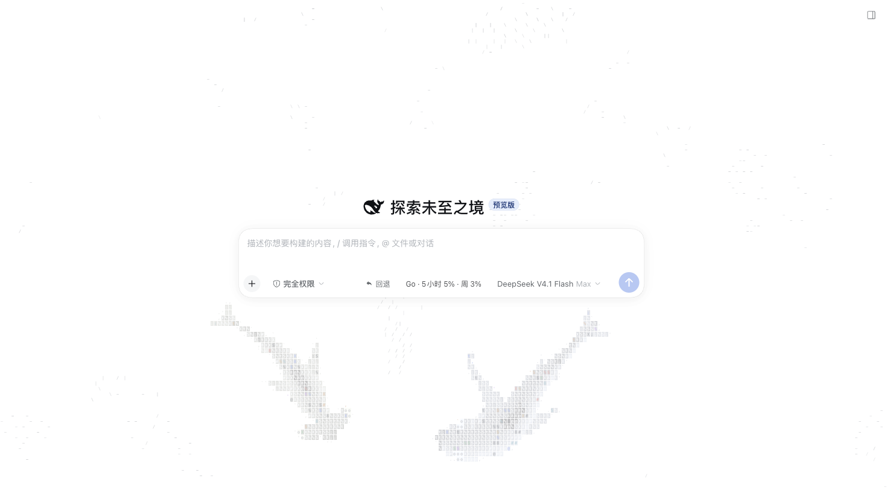
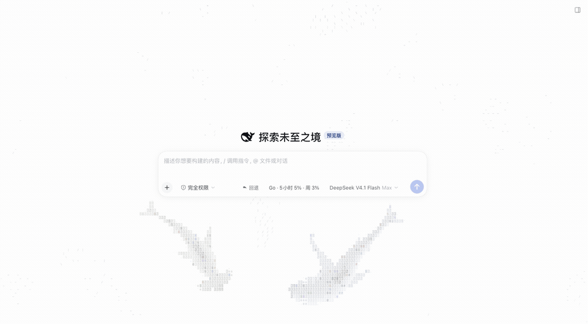

# dsh-ascii-sharks

[](https://www.npmjs.com/package/dsh-ascii-sharks)
[](LICENSE)
[](https://github.com/Timelk/dsh-ascii-sharks)
[](https://github.com/Timelk/dsh-ascii-sharks/stargazers)

给 [DeepSeek Harness](https://github.com/deepseek-ai/deepseek-harness) 换一片会呼吸的背景：
整页透明的 ASCII 海洋，鱼群 flocking、鲨鱼巡游、点击炸水花，主内容栏压一层羽化毛玻璃，
文字照常读，水面在玻璃后面慢慢动。

基于 [stackedlol/ascii-sharks](https://github.com/stackedlol/ascii-sharks)（MIT）的模拟与字符渲染器，
重写为 dsh 的 Client 插件。





## 源自 ascii-sharks

这个插件能成立，几乎全靠 [@stackedlol](https://github.com/stackedlol) 的
**[ascii-sharks](https://github.com/stackedlol/ascii-sharks)**：boids 鱼群、鲨鱼追猎与饥饿、
尾迹扩散、按细胞超采样出来的字符鲨鱼，整套模拟和渲染都在那个仓库里——零依赖、MIT、代码干净得像教科书，
连“鱼群受惊会像波纹一样传开”这种细节都写进了注释。

我们做的只是把它搬进 dsh：整页透明画布、环面环绕、按主题换墨、主栏毛玻璃和一组可调参数。
**好看的部分是上游的功劳**；如果你喜欢这个效果，去给 [ascii-sharks](https://github.com/stackedlol/ascii-sharks) 点个 ⭐。

## 特性

- **整页背景**：视口大小的透明 canvas 挂在 `body` 首位（`z-index: 0`、`pointer-events: none`），
  应用框架整体上浮在它之上——不是一个小面板。
- **跟随主题换墨**：浅色主题用深墨、深色主题用浅墨，监听 `theme/change` 实时切换。
- **主栏毛玻璃**：对话主栏 `backdrop-filter` + 半透明底衬，四边用类高斯遮罩羽化，
  鲨鱼在玻璃后是柔光斑块，不抢正文。
- **环面海洋**：鲨鱼头越过边界时整条脊柱平移，渲染器在对侧补画越界部分，游出去就从另一侧游进来；
  鱼群同样环绕，并在接缝前两格淡出，不会突然消失。
- **顺滑转向**：鱼群转向角速度限速 + 航向低通，字符随航向变成 `-` `\` `|` `/`，转弯能看出弧线。
- **可调细节**：字符尺寸 4–14px、鲨鱼 8 种、鱼群密度、游动速度、背景浓度、玻璃模糊都能拖。
- **省电**：`prefers-reduced-motion` 下自动静帧；页面不可见时由浏览器暂停 rAF。

## 安装

### 1. npm（推荐）

在 dsh 里让 agent 调用，或直接执行同名的 `plugin_manager` 工具：

```jsonc
{ "action": "install_bundle", "target": "dsh-ascii-sharks" }
```

### 2. GitHub Release

```jsonc
{
  "action": "install_bundle",
  "target": "https://codeload.github.com/Timelk/dsh-ascii-sharks/tar.gz/refs/tags/v1.0.2"
}
```

安装后刷新页面即可；设置 → **ASCII 鲨鱼** 调整参数。

### 3. 本地开发

```bash
git clone https://github.com/Timelk/dsh-ascii-sharks.git
cd dsh-ascii-sharks
bun build.mjs          # 生成 client.js
```

然后在 profile 里 `link:` 这个目录，并把 `dsh-ascii-sharks` 加进 `dsh.profile.bundles`；
或者直接 `install_bundle` 传绝对路径。

## 配置

设置 → **ASCII 鲨鱼**，全部即时生效，存在浏览器 `localStorage: dsh.ascii-sharks.v2`。

| 设置 | 范围 | 默认 | 作用 |
| --- | --- | --- | --- |
| 显示海洋 | 开/关 | 开 | 挂载水面层与页面表面覆盖；关闭即恢复不透明 |
| 背景浓度 | 8–100% | 90% | 整层水面的不透明度 |
| 细胞网格 | 开/关 | 关 | 铺一层淡 ASCII 网格 |
| 主内容毛玻璃 | 0–32px | 8px | 对话主栏背后的模糊半径，0 关闭 |
| 字符尺寸 | 4–14px | 6px | 单个 ASCII 格子宽度，越小越精致 |
| 鲨鱼种类 | 8 种多选 | 经典 + 双髻 | 至少保留一种，数量多于种类时循环 |
| 鲨鱼数量 | 1–6 | 2 | 同时在场的大鲨鱼 |
| 鱼群密度 | 20–200% | 100% | 按窗口面积自动算出的鱼群数量倍率 |
| 游动速度 | 30–220% | 100% | 整体模拟速率 |
| 鼠标惊扰 | 开/关 | 开 | 指针掠过时鱼群躲开 |
| 点击水花 | 开/关 | 开 | 页面任意处点击炸水花 |

## 工作原理

| 关注点 | 做法 |
| --- | --- |
| 渲染位置 | `body` 首位一个 `position: fixed` 的透明 canvas（`z-index: 0`），应用框架本身是 `position: relative`，天然盖在它上面 |
| 页面透水 | `ctx.theme.overrideTokens('ascii-sharks', …)` 把 `--dsw-alias-bg-base` / `--dsw-specific-sidebar-fill` 调成半透明；关闭插件时自动撤销 |
| 主栏玻璃 | 从 `[data-composer-dock]` 往上找到占满视口的对话列，内联 `backdrop-filter` + 羽化 `mask-image`；面板切换后由 `MutationObserver`（400ms 防抖）补回 |
| 墨色 | `ctx.on('theme/change')` → `renderer.setPalette(dark)` |
| 环面 | `World` 里头部越界即平移脊柱；`AsciiRenderer.rasterizeShark(sh, t, ox, oy)` 在对侧补采样一份 |
| 参数 | 本地 `localStorage` store + `subscribe`，滑杆改动直接 `engine.setOptions()` |

## dsh 插件标识

dsh 通过 `package.json` 里的 `dsh` 字段识别这个包（`manifestVersion: 1`）：

```jsonc
{
  "name": "dsh-ascii-sharks",
  "icon": "./icon.svg",
  "engines": { "node": "^22.19.0 || >=24.0.0", "dsh": ">=0.1.5-rc.1" },
  "dsh": {
    "manifestVersion": 1,
    "bundle": { "patch": "./cordis.patch.yml" },   // Host 层：插入 ascii-sharks 这一行
    "client": {                                     // 浏览器层：一个 web Client 模块
      "platform": "web",
      "immediately": true,
      "inject": ["@deepseek-ai/dsh-client-ui-conversation", "@deepseek-ai/dsh-client-ui-settings"]
    }
  }
}
```

配套文件：

- `cordis.patch.yml` — `insert: [{ id: ascii-sharks, name: dsh-ascii-sharks }]`
- `locale/zh.json`、`locale/en.json` — 插件管理器的标题/描述（`meta.title` / `meta.description`）
- `icon.svg` — 插件图标（≤256 KiB，包内相对路径）
- `client.js` — 由 `build.mjs` 生成的 `window.__ModuleLoader__` 模块

## 开发

```bash
bun build.mjs     # src/entry.ts + src/ocean/*.ts → client.js
npm run check     # 语法自检
```

```
src/entry.ts       槽位注册、设置页、localStorage 配置、玻璃与 token 覆盖
src/ocean/world.ts      boid 鱼群 + 鲨鱼追猎 + 环面
src/ocean/renderer.ts   细胞网格光栅化、尾迹、按主题换墨
src/ocean/engine.ts     固定步长循环、resize、指针输入、reduced-motion
src/ocean/species.ts    鱼种参数
```

需要 [Bun](https://bun.sh) 打包（TypeScript → CJS → 模块装载器外壳），运行时不需要它。

## 兼容性

- dsh `>=0.1.5-rc.1`（Web profile）
- Node `^22.19.0 || >=24.0.0`
- 浏览器需支持 `backdrop-filter` 与 `mask-composite`（Chrome/Edge 120+、Safari 17.4+）

## English

A whole-page ASCII ocean for DeepSeek Harness: a transparent, viewport-sized canvas sits behind the
app frame, boid schools and hunting sharks swim across it, and the conversation column carries a
feathered frosted-glass pane so the water stays ambient behind text. Ink follows the active color
scheme, the world is a torus (sharks and fish wrap at the edges), and every parameter — water
density, cell size, glass blur, species, population, speed, pointer interaction — is live in
Settings → ASCII Sharks.

Install with `plugin_manager install_bundle` targeting `dsh-ascii-sharks`, then refresh.

It stands on [ascii-sharks](https://github.com/stackedlol/ascii-sharks) by
[@stackedlol](https://github.com/stackedlol) — a zero-dependency, MIT-licensed artificial-life sim with
Reynolds boids, Couzin-style zones, a follow-the-leader shark spine and a cell-by-cell ASCII
rasterizer. The good-looking part is upstream work; this package only puts it on a dsh stage.
If you enjoy the effect, please star the original.

## 致谢与许可

- 模拟与字符渲染器来自 [ascii-sharks](https://github.com/stackedlol/ascii-sharks)（MIT）。
  那是一个做得很漂亮的 artificial-life 小项目：Reynolds boids、Couzin 式分区、鲨鱼跟随脊柱、
  字符级超采样，全部零依赖跑在 canvas 上。这个 dsh 插件只是给它换了个舞台，
  真正的功劳在 [@stackedlol](https://github.com/stackedlol) 那边，改动说明见
  [THIRD_PARTY_NOTICES.md](THIRD_PARTY_NOTICES.md)。
- 本插件代码 MIT，见 [LICENSE](LICENSE)。

如果它让你的 dsh 好看了一点，欢迎点个 ⭐。
